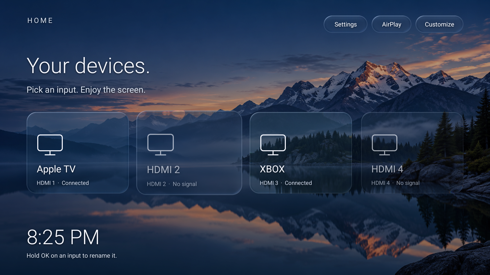
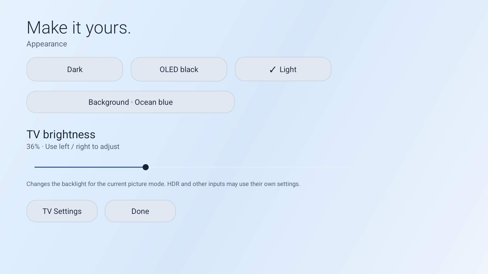

# Quiet Home

A small, ad-free Android TV launcher focused on HDMI devices. Built for TCL Google TV, with a clean remote-friendly home screen instead of recommendations and promotions.



## Features

- HDMI input tiles with device names and connection status from Android's TV Input Framework.
- Native TCL player handles input switching and video playback.
- Hold OK on an input to rename it locally.
- Settings and AirPlay shortcuts.
- Dark, OLED black, and Light themes.
- Eight gradient backgrounds: Original Midnight, Ocean Blue, Aurora Teal, Forest Green, Sunset Amber, Rose, Purple Haze, and Graphite. Each has dark and light variants.
- TV brightness slider using TCL's panel-backlight API, adjustable with the remote's left/right arrows.
- Development version: optional Liquid Glass surfaces in Customize (Android 13+), with refracted gradient colors, directional edge highlights, and short focus animations. See [rendering and performance notes](docs/performance.md).
- Development version: three offline landscape wallpapers, larger bottom-left clock, and compact top-right controls. See [wallpaper sources and resolution details](docs/wallpapers.md).
- No internet permission, advertising, analytics, accounts, or third-party app libraries.



## Compatibility

Tested on a **TCL 65QM6K**, G08 platform, Android 14 / AU14 firmware. This is a TCL-specific first release, not a universal Android TV launcher.

Input switching launches `com.tcl.tv/com.tcl.player.TVActivity`. Physical HDMI port labels use G08 identifiers HW15–HW18. Brightness uses the TV's optional `com.tcl.tv.display` shared library through `TvBacklightManager`; if unavailable or denied, the slider is disabled and TV Settings remains accessible.

The app leaves HDR, VRR, local dimming, CEC, picture processing, Apple services, and firmware updates to the TV's existing software. Replacing Home does not eliminate telemetry elsewhere in the firmware. Connection status can report no signal for sleeping devices. Firmware updates may restore the Google launcher.

## Download

Get `Quiet-Home-v0.1.apk` from the repository's **Releases** page. Release assets also include SHA-256 checksums.

## Install and try it first

With Android platform-tools installed and an authorized ADB connection to your TV:

```sh
adb install -r Quiet-Home-v0.1.apk
adb shell am start -n local.quiethome/.HomeActivity
```

If ADB sees multiple transports or devices, select your TV explicitly with `adb -s SERIAL ...`. Pairing and connection use different wireless-debugging ports.

Test HDMI switching, Settings, AirPlay, HomeKit, and remote navigation before replacing Home.

## Set as Home

First try the normal Home preference:

```sh
adb shell cmd package set-home-activity --user 0 local.quiethome/.HomeActivity
adb shell input keyevent 3
```

On the tested firmware, TCL still chose the stock Google Home because it has higher intent priority. This set required disabling the Google launcher and setup recovery package, reversibly:

```sh
adb shell pm disable-user --user 0 com.google.android.apps.tv.launcherx
adb shell pm disable-user --user 0 com.google.android.tungsten.setupwraith
adb shell cmd package set-home-activity --user 0 local.quiethome/.HomeActivity
adb shell input keyevent 3
```

Save the original package states first. These commands are specific to the tested, already-provisioned TV; do not apply them during initial setup or assume they work on other models. They disable packages for user 0, without uninstalling or clearing data. On the tested set the ADB connection dropped during the switch and wireless debugging had to be re-enabled; the cause was not established.

Verify Home from an HDMI input, then check TV Settings, HDMI/CEC, picture controls, AirPlay/HomeKit, and a restart. Turn wireless debugging off when finished.

## Customize

Open **Home → Customize** to choose the appearance, gradient, and brightness. Settings save locally. OLED black is a visual theme with a pure-black background; choosing a gradient from OLED switches to Dark.

Brightness changes the backlight for the **current picture context** using `EN_APPLY_CURRENT` and `EN_TCL_ACT_EXEC_SAVE`. HDR and other inputs may retain their own values. The slider ranges from 1–100 and remote arrows move five points. It does not change contrast, local dimming, HDR settings, or picture mode.

## Restore Google Home

The included `restore-google-home.sh` restores the package default states recorded on the tested TV, selects its original Basic TV Home activity, and presses Home:

```sh
sh restore-google-home.sh
# With more than one device:
ADB_SERIAL=YOUR_TV_SERIAL sh restore-google-home.sh
```

Use your own saved states if they differed. No need to uninstall Quiet Home to restore Google Home.

## Build from source

Requires a JDK with Java 8 compilation support, Python 3, `zip`, and the Android SDK. The build uses SDK tools directly, without Gradle or downloaded app dependencies.

Defaults tested on macOS:

- SDK: `$HOME/Library/Android/sdk`
- Build tools: `36.0.0`
- Platform: `android-36.1`
- Minimum Android API: 26; target API: 34

```sh
bash build.sh
# Or point to another SDK/version:
ANDROID_SDK_ROOT=/path/to/sdk BUILD_TOOLS_VERSION=36.0.0 ANDROID_PLATFORM=android-36.1 bash build.sh
```

The signed APK is written to `quiet-home.apk`. Intermediate files live in `build/`. A local signing key and random password are generated under `.local/`; both directories and APKs are ignored by Git. Keep the signing key and password private and backed up: future updates must use the same key to install over an existing build. Builds made with a different key cannot update the published APK in place.

Source: `src/local/quiethome/HomeActivity.java`. App manifest: `AndroidManifest.xml`.

## v0.1 validation

Verified on the tested TV: four HDMI inputs discovered, Apple TV on HDMI 1 and Xbox on HDMI 3 named through the TV, Apple TV selection through TCL's player, Home returning to Quiet Home, theme rendering, gradient selection, and panel backlight set/read at 100 → 95 → 100 with remote arrows. This is not certification for other TCL firmware or models.
